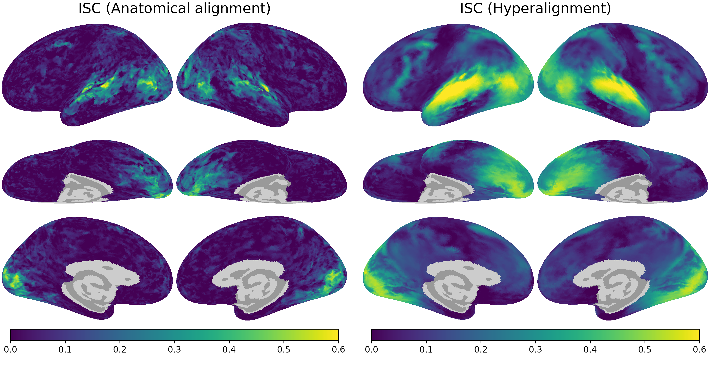
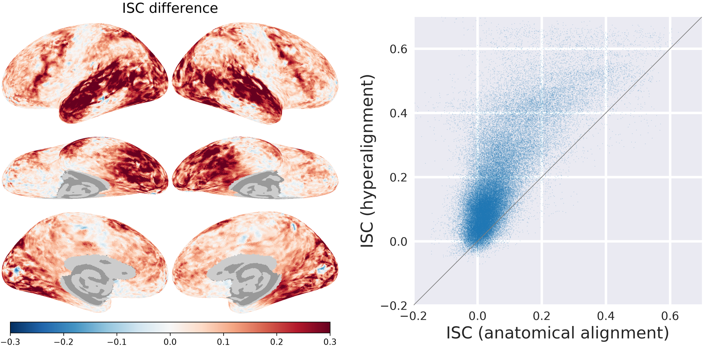

Hyperalignment finds, for each participant, a transformation that brings their brain data into a common functional space.
This page walks through connectivity hyperalignment (Guntupalli et al., 2018, PLOS Computational Biology), using functional connectivity profiles to align participants to the HyperBrain-Sparta template.
The template itself, and `nb.tpl`, are described in [HyperBrain functional templates](templates.qmd).

The example aligns two participants in the [Forrest](../reference/Forrest.qmd) dataset, in which participants watched the movie *Forrest Gump* over 8 runs.
Runs 1–4 are used to estimate the transformations, and runs 5–8 to evaluate them with inter-subject correlation (ISC).
The hyperalignment algorithms come from the separate [`hyperalignment`](https://pypi.org/project/hyperalignment/) package (see [Installation](installation.qmd#optional-packages)).

## Overview

For each participant, the procedure has four steps:

1. Load the training runs in the `onavg-ico64` space.
2. Compute the connectivity profile of each vertex: its correlation with each of the connectivity targets.
3. Estimate the transformation by aligning the participant's connectivity profiles to the template.
4. Apply the transformation to the participant's held-out runs and evaluate alignment with ISC.

First, import the packages and set up the analysis:

```python
import numpy as np
from scipy.stats import zscore
import neuroboros as nb
from hyperalignment import (
    initialize_sparse_matrix, searchlight_ridge, searchlight_weights,
)

dset = nb.dataset('forrest')
train_runs = [1, 2, 3, 4]
test_runs = [5, 6, 7, 8]
radius = 20  # searchlight radius in mm
```

## Load the template and participant data

The template is loaded for both hemispheres, with the standard cortical masks applied.
Its rows are the connectivity targets, the `onavg-ico8` vertices of both hemispheres, and its columns are the `onavg-ico64` vertices of both hemispheres:

```python
tpl = nb.tpl('lr')
tpl.shape  # (1210, 77326)
```

Next, load the first participant's training data.
`dset.get_data` returns the preprocessed data of the requested runs, concatenated along the time axis.
The columns are the same masked `onavg-ico64` vertices as the template's:

```python
dm = dset.get_data('01', 'forrest', train_runs, 'lr', space='onavg-ico64')
dm.shape  # (1818, 77326)
```

## Compute connectivity profiles

Obtain the target time series by resampling the participant's data from `onavg-ico64` to `onavg-ico8`.
With `mask=True`, the mapping's rows follow the template's masked vertex order, and its columns follow the template's masked target order.
Multiplying `dm @ M` gives one time series per target:

```python
M = nb.mapping('lr', 'onavg-ico64', 'onavg-ico8', mask=True)
M.shape  # (77326, 1210)
targets = dm @ M
```

The connectivity profile of a vertex is its Pearson correlation with each target.
Z-score the time series, then compute the correlations as normalized dot products:

```python
conn = zscore(targets, axis=0).T @ zscore(dm, axis=0) / dm.shape[0]
conn = np.nan_to_num(conn)  # vertices without signal have a zero profile
conn.shape  # (1210, 77326)
```

`conn` now has the same layout as the template: targets in rows and vertices in columns.

## Estimate the transformation

The transformation is estimated locally, within searchlights of 20 mm radius.
The searchlights contain `onavg-ico64` vertices but are centered on the coarser `onavg-ico32` vertices, which keeps their number manageable.
In each searchlight, ridge regression finds the linear combinations of the participant's vertices that best predict the template's connectivity profiles.
The overlapping local transformations are combined into a single sparse matrix using distance-based weights, which give more weight to vertices near each searchlight's center:

```python
sls, dists = nb.sls(
    'lr', radius, space='onavg-ico64', center_space='onavg-ico32',
    return_dists=True)
weights = searchlight_weights(sls, dists, radius)
len(sls)  # 19341
mat0 = initialize_sparse_matrix(sls)
xfm = searchlight_ridge(conn, tpl, sls, mat0=mat0, weights=weights)
xfm.shape  # (77326, 77326)
```

::: {.column-margin}
`mat0` preallocates the sparsity pattern determined by the searchlights.
Reusing this empty matrix for each participant avoids repeatedly building that structure; each participant still gets a separately fitted transformation.
:::

The rows of `xfm` are the participant's vertices and the columns are the template's vertices.

## Apply the transformation to new data

The transformation can be applied to other data from the same participant, such as held-out runs or contrast maps.
The input must use the same space, cortical mask, and vertex ordering as the training data.
Multiplying the data by `xfm` brings it into the template's space:

```python
dm_test = dset.get_data(
    '01', 'forrest', test_runs, 'lr', space='onavg-ico64')
aligned = dm_test @ xfm
aligned.shape  # (1781, 77326)
```

`xfm` can be saved as a sparse matrix with `nb.save('xfm_01.npz', xfm)` and loaded again with `nb.load`.

## Align the second participant

Reuse the template, mapping, searchlights, and sparsity pattern for participant `02`.
Here, `nb.record` caches the connectivity profiles and fitted transformation (see [Saving, loading, and caching results](io.qmd)):

```python
def connectivity(dm):
    targets = dm @ M
    conn = zscore(targets, axis=0).T @ zscore(dm, axis=0) / dm.shape[0]
    return np.nan_to_num(conn)

sid = '02'
dm = dset.get_data(sid, 'forrest', train_runs, 'lr', space='onavg-ico64')
conn = nb.record(f'conn_{sid}.npy', connectivity, return_results=True)(dm)
xfm = nb.record(f'xfm_{sid}.npz', searchlight_ridge, return_results=True)(
    conn, tpl, sls, mat0=mat0, weights=weights)
dm_test_2 = dset.get_data(
    sid, 'forrest', test_runs, 'lr', space='onavg-ico64')
aligned_2 = dm_test_2 @ xfm
```

## Compare inter-subject correlation

ISC measures, for each vertex, how similar the time series of a participant is to those of the other participants while they watch the same movie.
We use the held-out runs to test whether hyperalignment improves this correspondence.
The anatomically aligned data (`AA`) are the test runs as loaded, and the hyperaligned data (`HA`) are the same runs after applying each participant's transformation:

```python
aa = nb.isc(np.stack([dm_test, dm_test_2]))
ha = nb.isc(np.stack([aligned, aligned_2]))
aa.shape  # (2, 77326)
```

`nb.isc` returns one row per participant, the correlation between that participant and the average of the others.
With two participants both rows are the same, so we keep the first:

```python
aa, ha = aa[0], ha[0]
aa.mean(), ha.mean(), (ha - aa).mean()  # (0.066, 0.182, 0.116)
```

Plot both ISC maps with the same color scale:

```python
img_aa = nb.plot(aa, vmin=0, vmax=0.6, title='ISC (Anatomical alignment)')
img_ha = nb.plot(ha, vmin=0, vmax=0.6, title='ISC (Hyperalignment)')
nb.Image.hstack([img_aa, img_ha], padding=60)
```

{fig-alt="ISC after anatomical alignment and after hyperalignment"}

The difference map shows the change in ISC at each vertex.
In the scatterplot, points above the diagonal indicate higher ISC after hyperalignment.
Use `nb.Image.hstack` to combine the brain plot with the matplotlib figure:

```python
import io
import matplotlib.pyplot as plt
import seaborn as sns
from PIL import Image

img_diff = nb.plot(
    ha - aa, vmin=-0.3, vmax=0.3, cmap='RdBu_r', title='ISC difference')

height = img_diff.img.size[1]  # match the height of the brain plot
with sns.axes_style('darkgrid'):
    fig, ax = plt.subplots(figsize=(height / 300, height / 300), dpi=300)
ax.plot([-0.2, 0.7], [-0.2, 0.7], color='gray', lw=0.8)
ax.scatter(aa, ha, s=1, alpha=0.2, lw=0)
ax.set_xlim(-0.2, 0.7)
ax.set_ylim(-0.2, 0.7)
ax.set_aspect('equal')
ax.set_xticks([-0.2, 0, 0.2, 0.4, 0.6])
ax.set_yticks([-0.2, 0, 0.2, 0.4, 0.6])
ax.set_xlabel('ISC (anatomical alignment)', fontsize=20)
ax.set_ylabel('ISC (hyperalignment)', fontsize=20)
ax.tick_params(labelsize=14)
ax.grid(lw=3)
fig.tight_layout()
buf = io.BytesIO()
fig.savefig(buf, format='png', dpi=300, facecolor='none')
plt.close(fig)
buf.seek(0)
img_scatter = nb.Image(Image.open(buf))

nb.Image.hstack([img_diff, img_scatter], padding=60)
```

{fig-alt="Difference in ISC between hyperalignment and anatomical alignment, and a scatterplot of the ISC values"}

Two participants are the minimum for ISC; in practice we align and compare many more.
With more participants, averaging the others' time series can reduce individual noise in the estimate of the shared response.

## Alternative: align one hemisphere at a time

To reduce memory use, estimate and save one hemisphere's transformation at a time.
Run this alternative in a fresh session after the setup code in [Overview](#overview), so the earlier bilateral arrays do not remain in memory.
The connectivity targets still come from both hemispheres, but their time series are much smaller than the vertex data:

```python
targets = np.concatenate([
    dset.get_data('01', 'forrest', train_runs, lr, space='onavg-ico64')
    @ nb.mapping(lr, 'onavg-ico64', 'onavg-ico8', mask=True)
    for lr in 'lr'], axis=1)
targets = zscore(targets, axis=0)

for lr in 'lr':
    tpl = nb.tpl(lr)
    sls, dists = nb.sls(
        lr, radius, space='onavg-ico64', center_space='onavg-ico32',
        return_dists=True)
    weights = searchlight_weights(sls, dists, radius)
    dm = dset.get_data('01', 'forrest', train_runs, lr, space='onavg-ico64')
    conn = np.nan_to_num(targets.T @ zscore(dm, axis=0) / dm.shape[0])
    xfm = searchlight_ridge(
        conn, tpl, sls, mat0=initialize_sparse_matrix(sls), weights=weights)
    nb.save(f'xfm_01_{lr}h.npz', xfm)
    del dm, conn, tpl, xfm, sls, dists, weights  # release this hemisphere's arrays
```

Because searchlights never cross hemispheres, these transformations are the two diagonal blocks of the bilateral transformation.
Apply each to the corresponding hemisphere's data:

```python
dm_l = dset.get_data('01', 'forrest', test_runs, 'l', space='onavg-ico64')
aligned_l = dm_l @ nb.load('xfm_01_lh.npz')
```
